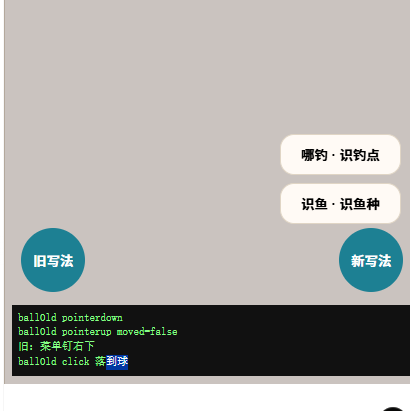
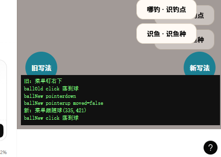

# 趣渔 · AI Prompt 历史快照

> 比赛材料：核心功能迭代的完整 Prompt 链
> 项目：趣渔（社区 / 票务 / 商城 / 塘主 SaaS）
> 代码版本：`v14-post-interaction` 分支 HEAD（源码 8.13.0；生产 8.12.0）
> 编制日期：2026-10-19
> 原始会话：`78f64457-e692-48e2-b8f0-75054467d555`、`f7ff7f6e-3311-4705-bcdd-d517dd7071c4`

---

## 导出说明

这份快照不是事后编写的“AI 使用心得”，而是从 Qoder 的 JSONL 会话日志里逐字抽取的对话记录，按四个核心迭代重组。每章包含：

1. **用户的原始 Prompt**（逐字，含时间）；
2. **AI 的修改建议与依据**（引用原话，保留它读过的文件、行号、约束）；
3. **用户的裁定**（结构化决策，取工具结果，不取可能回填错的入参）；
4. **落地提交与文件**；
5. **Bug 修复链**（包括 AI 判断错误、被用户证据推翻、以及回滚）；
6. **验证证据与未验证边界**。

### 两条编排规则

- **只写日志里有的**。AI 的自我总结不当作事实；能用提交、测试、线上哈希复核的，才写成结论。
- **不抹掉错误**。案例二保留了“base64 通道不存在”的错误前提与返工；案例四保留了被用户截图证伪的假设②；案例一保留了 B-24 误报。这些是 Prompt 链的一部分，不是需要修饰的瑕疵。

### 会话源与校验

| 会话 | 字节 | SHA256 |
|---|---:|---|
| `78f64457-e692-48e2-b8f0-75054467d555.jsonl` | 12,600,829 | `6095da2415e45d37f24d66c0ccd404d23a583fe70055728330aca511256b3b89` |
| `f7ff7f6e-3311-4705-bcdd-d517dd7071c4.jsonl` | 4,335,643 | `894a392d3638351d55c1563542b1bad1d6f2d074fedcb63e472a119fcd94f7e1` |

原始 JSONL 不随仓库分发（体积大、含本地路径）；本文件中的引文可按上述哈希定位到同一份会话。单章文件与合订本内容一致，评审可按需选择阅读方式。

### 目录

1. 案例一：v14 帖子交互重构——从一句需求到 13 次裁定
2. 案例二：图片落盘与机审返工——AI 先给错前提，再自己推翻
3. 案例三：v15 识鱼——上线前审计出六类阻断项
4. 案例四：B-45——一句“哪钓打不开”，两个假设，一次回滚

---

## 案例一：v14 帖子交互重构——从一句需求到 13 次裁定

> **会话**：`78f64457-e692-48e2-b8f0-75054467d555`
> **时间**：2026-10-06 17:50 → 2026-10-07 10:38（CST）
> **对应提交**：59 条（`134dcd3..84f95ff`），核心落地 `a8be879` / `ef184cb` / `a3b9ea7`
> **上线**：2026-10-07 15:15，app 8.12.0，`verify:deploy --tar` 10/10 PASS

---

### 1. 起点：一句话，没有方案

用户的第一条输入是完整原文：

> **Prompt 1**（2026-10-06 17:50）
>
> [@Grill Me](plugin://grillme-matt@qoder-marketplace) 我想对这个项目帖子做一些优化，如打开帖子，帖子详情页，帖子评论等交互

没有指定页面结构、没有数据库要求、没有验收标准。AI 的第一步不是给方案，而是读代码。它先确认了项目身份与技术栈，再把「帖子线」的现状拆成两类：

- **A 类 · 纯前端交互**：返回丢状态、详情页双击点赞时序写反、整卡不可点、无图片放大、键盘顶飞底栏、`feed.invalidate()` 大锤等 8 项；
- **B 类 · 能力缺口**：收藏是假的（只有前端 state）、点赞态不回显、评论硬截断 50 条、评论无点赞/删除/图片、同一份评论数据两种形态、评论头像是算法编的等 6 项。

同时给出了三条会卡住方案的硬约束：动画门禁禁止首屏静态闭包使用 `layoutId`/`drag`；首屏主 JS 预算 ≤70KB br、总传输基线 189.0KB br 不得回退；B 类要跑生产 MySQL 迁移。

**这段的价值不在于列了多少问题，而在于它把“优化交互”翻译成了可裁定的技术分叉。** 后续 13 个问题全部建立在这些事实上。

---

### 2. Prompt 链：用户输入 + AI 反问

比赛要求「完整 Prompt 链」。本案例的用户侧输入有两种：3 条自由输入，以及 13 次结构化决策。后者由 AI 用 `AskUserQuestion` 逐题提出，用户选择；问答原文都在会话日志里。

#### 2.1 自由输入

| # | 时间（CST） | 原文 | 作用 |
|---|---|---|---|
| 1 | 10-06 17:50 | `我想对这个项目帖子做一些优化，如打开帖子，帖子详情页，帖子评论等交互` | 定义主题 |
| 2 | 10-06 17:55 | `继续` | 首次请求被用户打断后恢复 |
| 3 | 10-07 10:38 | `继续` | 长任务续跑 |

> 说明：v14 的推进主要靠结构化决策，不是靠长 Prompt。这是刻意的交互方式——一次只问一个会影响实现的问题，避免一口气抛出 25 项让用户凭感觉勾选。

#### 2.2 十三次裁定

下表「用户选择」一律取自工具结果 `Your questions have been answered: …`，不是工具入参里的回填值（原因见 §2.3）。

| # | AI 的问题 | 用户裁定 | 对实现的直接影响 |
|---:|---|---|---|
| 1 | 范围边界：A 类纯前端 / B 类动 DB？ | **A + B 全做** | 25 项、生产迁移、第三方服务 |
| 2 | 列表内点击帖子用什么方式打开？ | **弹层详情 + URL 同步** | Home 不卸载，返回状态从根上保住 |
| 3 | 列表页评论按钮的行为？ | **删 CommentSheet，开 PostSheet 并弹键盘** | 全局只剩一种看帖形态，−150 行 |
| 4 | 评论点赞存哪里？ | **新建 comment_likes 表** | 避开 `likes` 表已知事务隐患 B-06 |
| 5 | 删评语义？ | **全软删 + 占位** | 不产生楼中楼孤儿 |
| 6 | 帖子收藏存到哪？ | **并入 /favorites 加 Tab** | 干掉「渔获集」幽灵术语 |
| 7 | 评论分页与楼中楼？ | **游标分页 + 折叠 + 热门/最新切换** | 两套游标语义 |
| 8 | 帖子图片 base64 存库怎么处理？ | **插入图片落盘修复，评论图建在其上** | 触发案例二 |
| 9 | 图片内容审核怎么补？ | **接阿里云内容安全机审** | 触发案例二 |
| 10 | 图片区单击/双击冲突？ | **整卡可点，信息流取消双击点赞** | 单击零延迟，详情内保留双击 |
| 11 | 懒加载 chunk 的零等待与体积红线？ | **idle 预加载 + 上滑转场** | LCP 后 `requestIdleCallback` 预热 |
| 12 | 25 项怎么分批？ | **一次性大版本** | 前端大改与 DB 迁移同批上线 |
| 13 | 存量 base64 图片迁移后怎么处理？ | **先备份全表，再原地改写为 URL** | 回滚预案从“重要”变“必须” |

#### 2.3 一个日志陷阱：入参里的 `answers` 不一定是用户答案

会话日志里，`AskUserQuestion` 的工具入参带 `answers`，工具结果又带一段 `Your questions have been answered`。两者在改选/多题场景下会不一致，本案例出现了两次：

| 问题 | 工具入参 `answers` | 工具结果（本文采用） |
|---|---|---|
| 范围边界 | 只做 B 类能力补齐 | A + B 全做 |
| 图片存储 | 只做传输瘦身，不落盘 | 插入“图片落盘”修复，图片评论建在其上 |

如果按入参写历史，案例二根本不会存在，整份 Prompt 快照也会变成假的。本文档的规则是：**以工具结果为准，并在原始 JSONL 里保留行号供复核**。这条规则本身也写进了 `docs/competition/README.md` §3.3。

---

### 3. AI 的关键建议与依据

#### 3.1 为什么是弹层，不是路由页

AI 先确认了路由结构，再给结论：

> `/` 和 `/post/:id` 是 Layout 下的兄弟路由（App.tsx:99,104）→ 进详情时 Home **整棵卸载**，这就是“返回全丢”的根因。

因此「纯路由 + 状态提升」需要把分页、滚动、tab、点赞态全部提升到路由层，改动面大且容易漏；「弹层 + `pushState`」让 Home 保持挂载，关闭时 `history.back()`，天然保住状态。`/post/:id` 路由页保留，只服务深链冷启动，两者共用 `PostContent`。

#### 3.2 一个做不了的转场，提前说清

> **图片 hero 共享元素转场（小红书那种图片飞入详情）在本项目做不了。** 它需要列表项和详情页两边都挂 `layoutId`，而 `FeedPost` 位于首屏静态闭包，`check-motion-boundary.mjs` 明令禁止 → build 直接失败。能做的转场只有整页淡入/上滑（不需要 `layoutId`）。

#### 3.3 门禁不是障碍，是设计输入

PostSheet 懒加载后带着 `CatchViewer`（`drag="x"`），会落进首屏静态闭包。AI 读完门禁脚本后给出精确逃逸路径：

- Home/FeedPost 必须用**动态 `import()`** 引入 PostSheet（门禁的 `resolveImports` 只跟静态 `import ... from`）；
- `PostDetail` 从 `<Lazy>` 升级为 `<LazyMax>`；
- 首次点击有下载延迟，用 idle 预热兜住。

这不是“绕过门禁”，而是把门禁的静态分析规则当成模块边界来设计。最终产物里 `PostSheet` 是独立 chunk，首屏 189.0KB br 基线未回退。

#### 3.4 「渔获集」是幽灵术语

> **「渔获集」是个幽灵术语**——全代码库只出现 1 次，就是 `Home.tsx:612` 那句 toast 文案，没有任何对应的表、页面或功能。

用户选择并入 `/favorites` 加 Tab 后，AI 把这个词写进 `CONTEXT.md` 的禁用清单。这是“需求对齐”产生的一个非代码产物：**术语裁定**。

#### 3.5 删除语义：为什么不是硬删

AI 指出硬删顶层评论会让子回复的 `parentId` 指向不存在的行。用户选择「全软删 + 占位」后，读取路径统一过滤 `deletedAt`，删除者与帖主有权限，占位文案保留楼层结构。

---

### 4. 落地：提交与文件

| 提交 | 内容 |
|---|---|
| `a8be879` | DB：`comment_likes`、`post_favorites`、`comments` 新列与索引 |
| `ef184cb` | API：帖子图片落盘、feed 载荷瘦身、评论体系、收藏；机审接线 |
| `a3b9ea7` | 前端：PostSheet 全屏弹层、删 CommentSheet、整卡可点、收藏/评论接后端 |
| `89d77b0` | 文档：v8.12.0 变更记录 + backlog 登记 8 项新发现 |

关键文件：

- `src/components/home/PostSheet.tsx`、`src/components/community/PostContent.tsx`
- `src/pages/Home.tsx`（动态 import + idle 预热）
- `api/services/community.ts`（评论/收藏/点赞）
- `db/schema.ts`、`db/migrations/0013_*`、`0014_*`

---

### 5. 修 Bug 链：用户如何引导 AI 收敛

#### 5.1 先修用户真碰到的两个死路

`dae3397` 修掉：

- 评论配图选图后界面挂死：喂进损坏/非图片文件时 `createImageBitmap` reject，旧的 `for … await compressImage()` 没有 `try/catch`，异常冒出后 `resolve()` 永不执行，外层 `await` 永久挂起。修法是逐张 `try/catch`，坏图跳过、好图保留、Promise 必定结算；
- 「加载更多评论」是死按钮：失败后再次写入同一个游标不改变 query key，react-query 不重发；修法是游标相同则走 `refetch()`，文案切成「重试加载评论」。

这两条不是代码审查发现的，是**在浏览器里真点出来的**。AI 把复现步骤和修复写进提交信息，后续回归有据可查。

#### 5.2 交付前双轴审查：一次修 6 项

`e938d7a` 的提交信息逐条记录了缺陷与修法。抽三条能说明“为什么静态检查不够”：

> - `FeedPost` 整卡 `onKeyDown` 不判 target：焦点在卡内按钮上按 Enter 会连带开弹层并 `preventDefault` 掉按钮自身激活 → 点赞/收藏/分享/更多全排键盘不可用
> - `CommentSection` 在途锁写成 `likeBusy != null`：一条评论点赞在飞时其它评论的点赞被静默吞掉
> - `PostContent` 删帖后 600ms 的 `onBack` 计时器无句柄：用户手动关闭后会二次 `history.back()`，把 Home 一起弹掉

这三条都通过 `tsc`/`eslint`，只在真实交互路径上出错。修复后新增 `verify:static` 入口，并把 `vitest` 加进 `build` 链——**单测不过就不产出可部署物**。

#### 5.3 举报面板：一次“差点修出新 Bug”的返工

`6d098ec` 修「举报面板关闭再打开仍留着上次内容」。AI 的第一版在提交时复位 state，它自己否掉了：

> 修法把 state 移进只在 open 期间挂载的内层组件，靠卸载丢弃：不用 `useEffect` 监听 open 复位（本项目 lint 红线 `set-state-in-effect`），也**不在提交时复位**——我第一版正是提交时复位，那会让“提交失败”把用户写好的说明一起清掉，等于自己引入一个新缺陷。

紧接着 `c0b7b6e` 给条件子元素补 `key`，因为“单个条件子元素没 key 也恰好能工作”是巧合不是保证。

#### 5.4 B-24：AI 报了一个不存在的回归，然后撤回

这是本案例最能说明“AI 建议需要被验证”的一段。

AI 用「指向不存在数据库的服务」造出断库冷启动，观察到信息流空白、无骨架、无 toast，判断 v14 把 `feedQuery.error` 改成派生值后兜底失效，立案 **B-24**（`68b4aed`），并尝试了三种判据都没触发。它没有继续盲改：

> 我连换三种判据（`isError` → 加 `errorUpdatedAt>0` → 再加“已结算但无 data”）都没能触发，说明查询落在我尚未识别的状态上——**继续换写法就是盲改**，所以我 `git checkout` 回退了两次试验改动。

用户回复：

> **Prompt**（2026-10-06 22:26）
>
> 好，那就把 B-24 查出根因。

AI 改用临时 DOM 诊断属性，把 react-query 的真实状态渲染出来，读一次后删掉诊断，最终结论是**误报**：

> **1. B-24 是我的误报，已撤回。** 兜底实测正常：断库冷启动 7 张演示卡 + toast + 点演示卡给出诚实提示，健康路径无误报。`Home.tsx:280` 的判据从头到尾是对的，三次试验改动都已回退。CHANGELOG/backlog/计划文档三处的错误结论已改正。

对应提交 `7d3fb54`。**这条链完整保留了“AI 提出错误判断 → 用户要求查根因 → AI 用可观测手段推翻自己 → 修文档”的全过程**，没有把误报从历史里抹掉。

---

### 6. 验证与上线

| 检查 | 结果 |
|---|---|
| `tsc -b` / `eslint` | 0 错误 |
| `vitest` | 23/23（当时），含机审请求形状 13 条、落盘顺序 8 条、缓存清空 2 条 |
| `verify:images` | 连真实 MySQL 的带图发布链路 PASSED |
| `verify:static` | 首屏 eager JS 148.7KB、CSS 6.44KB、按需 chunk 1.3–1.4KB，全通过 |
| `verify:handoff --tar r8` | 0 失败 |
| `verify:deploy --tar r8` | 10/10 PASS，含线上入口 JS 与交付包逐字节一致 |
| 线上切换 | `/opt/quyu/dist/boot.js` 由 `6b5897df…`（8.11.0）变为 `7775cba9…`（8.12.0） |

上线过程中的两个坑也写进了 CHANGELOG：文档里记的旧包 sha 与实际不符，照文档跑会让 sha 闸门放行错产物；回滚脚本此前根本不在服务器上。这两条直接促成了后来的 `verify:handoff` 泛化（案例三）。

---

### 7. 没有做到的

**三条真机 UI 行为至今没有人点过**（`c0b7b6e` 的提交信息已如实写明）：

1. 举报弹层关闭再打开应为空白；
2. 关注按钮的乐观态不能被后台 refetch 盖回；
3. 退出登录后查看器级状态应清空。

原因不是没写测试，而是当时仓库没有 jsdom、本机无 npm 装不了，浏览器自动化也不可用；这三条只有真实浏览器/真机能验。它们被写进交付清单和「明确未做」，没有被算进 23 条单测的绿灯里。

---

### 8. 证据索引

| 证据 | 位置 |
|---|---|
| 原始会话 | `78f64457-e692-48e2-b8f0-75054467d555.jsonl`，SHA256 `6095da24…` |
| 用户首条输入 | 该 JSONL 第 4 行 |
| 范围裁定 | 第 70–72 行（工具入参与结果不一致，取结果） |
| 图片存储裁定 | 第 200–202 行（同上） |
| B-24 立案 / 撤回 | 第 2022 / 3433 行附近；提交 `68b4aed` / `7d3fb54` |
| 核心提交 | `git show a8be879 ef184cb a3b9ea7 e938d7a 6d098ec c0b7b6e` |
| 上线记录 | `CHANGELOG.md` v8.12.0「部署记录（2026-10-07 15:13–15:16 CST）」 |

---

## 案例二：图片落盘与机审返工——AI 先给错前提，再自己推翻

> **会话**：`78f64457-e692-48e2-b8f0-75054467d555`
> **时间**：2026-10-06 18:11 → 23:25（CST）
> **对应提交**：`ef184cb`（落盘 + 瘦身）、`f1795ba`（机审返工）、`ff036e9` / `eb68c1c`（顺序契约）、`b0eda44`（真库冒烟）
> **结论先行**：落盘链路已上线；**机审在生产上是关闭的**，且从未打过真实网关。

---

### 1. 起点：一个比“交互优化”严重得多的问题

案例一问到「图片评论怎么做」时，AI 去查现有的上传链路，结果发现**根本不存在 `/api/upload`**：帖子图片是 base64 直接写进 MySQL 的 `posts.images` JSON 列。

> **AI 的原话**（2026-10-06 18:11）
>
> ⚠️ 挖到一个**必须先告诉你的生产隐患**，它会影响本轮范围：
>
> **帖子图片是 base64 直接存进 MySQL 的。**
> - `pickImages()` 返回压缩后的 **dataURL**（最长边 1600px，JPEG q0.82）
> - `Publish.tsx:121` 把它原样塞进 `images: photos`
> - `createPost` 直接 `images: input.images` 写进 `posts.images` JSON 列
> - **没有 `/api/upload` 路由**，没有落盘，没有大小校验；`boot.ts:15` 的 `bodyLimit` 是 **50MB**，等于不设防

它没有停在“这是个坏味道”，而是列了四种必然的爆炸方式：

1. `recallCandidates()` 全列读 + 进程内存缓存 → 几十个真实九图帖就能撑爆单机 Node；
2. feed 全量透传 → 一条真实图帖让首屏从 189KB 涨到 MB 级，v12 性能专项归零；
3. 单个九图帖约 2–4MB base64，逼近 `max_allowed_packet` 时 INSERT 静默失败；
4. 同一份 base64 在召回缓存、打分、MMR、页缓存里被复制多份。

#### 第一次裁定

AI 给出四个选项，工具入参记录的是「只做传输瘦身，不落盘」，但工具结果里的用户答案是：

> `Your questions have been answered: "帖子图片 base64 存库这个隐患，本轮怎么处理？"="插入“图片落盘”修复，图片评论建在其上"`

这个选择把范围从“前端交互”扩到了“存储链路 + 合规”。AI 立刻指出下一步的硬约束：项目**完全没有图片机审能力**，而图片评论会把无审核的 UGC 图片入口从一个扩大到两个。

#### 第二次裁定

> `"图片内容审核怎么补？（这是硬合规项，不能默默绕过）"="接阿里云内容安全机审"`

至此，本轮同时接入了两件不可逆的事：**存量图片地址改写**与**第三方内容安全服务**。

---

### 2. AI 的第一个错误前提

为了接机审，AI 先把客户端写了出来，并在文档里写下“阿里云内容安全支持 base64 提交”。这个前提让它选择了**审核先于落盘**的顺序——图片还在内存里，直接 base64 发给网关，违规就不写盘，听起来更安全。

但它在后续自查时去核对了官方文档，然后推翻了这句话：

> **AI 的更正**（2026-10-06 23:01）
>
> **2. 核实 B-24 时顺手复核了自己写下的“官方文档确认支持 base64 提交”——那句话是错的。** 内容安全两版接口（70292 的 2018-05-09、增强版 2022-03-02）**都只接受可被服务端拉取的图片 URL**，没有 base64 通道。旧实现启用后每次调用都会 4xx，再被我自己那套“失败就放行 + 转人工”的降级口径吞掉，表现成“机审已接入”而实际一张都没审成。

这段话值得逐字读：错误不是“接口调不通”这种显性失败，而是**4xx 被降级口径折叠成 `unavailable`，然后被当成“已接入”**。如果没有回查官方文档，这个功能会以“绿灯”的形态上线，一张图都不审。

对应提交 `f1795ba`，提交信息把三处根因写得很清楚：

> 顺文档改掉三处：请求体改 `{scenes, tasks:[{dataId,url}]}`；补发四个必有的 `x-acs-*` 头并让它们参与 `CanonicalizedHeaders`；`Content-MD5` 不再 `.toUpperCase()`（base64 大小写敏感）。
>
> 顺序因此改为「全部落盘 → 按公网 URL 审 → 明确违规则删掉本次新写的所有文件再拒收」，代价是一段最长 3s 的公网可达窗口，收益是链路真能跑通，且顺手修掉了旧注释里承认的孤儿文件遗留。

---

### 3. 重做后的链路

```text
用户选图（dataURL）
  → ingestImages() 校验类型/张数/路径穿越
  → 写盘 uploads/{posts,comments}/
  → 拼公网 URL（PUBLIC_MEDIA_BASE_URL）
  → moderateImages() 逐张提交阿里云
      ├─ pass        → 保留文件，写库
      ├─ reject      → 删除“本次新写”的全部文件，拒收发布
      ├─ review      → 保留文件，写一条 [系统] 待人工复核
      └─ unavailable → 保留文件，写一条 [系统] 待人工复核
  → 发布成功
```

几个容易被忽略、但提交里有明确断言的点：

- **`Content-MD5` 大小写**：base64 大小写敏感，旧实现 `.toUpperCase()` 会让网关算出的 MD5 与请求头不一致，必然 4xx。
- **四个 `x-acs-*` 头必须参与签名**：只加头不参与 `CanonicalizedHeaders`，签名仍然错。
- **reject 只回滚本次新写**：编辑帖子时，同批里已有的旧图不能被误删。`eb68c1c` 专门补了这条护栏。
- **结果条数少于图片数**（审核服务半路挂掉）时，缺位按待审处理，不能漏文件。

---

### 4. 测试：把“请求长什么样”钉住

这是项目第一份 API 层单测。`api/services/imageModeration.test.ts` 用 mock `fetch` 断言：

- 请求体是 `{scenes, tasks:[{dataId,url}]}`，不是 base64；
- 必发四个 `x-acs-*` 头，`Content-MD5` 等于对 body 重算的标准 base64，且**不等于它的大写形式**；
- `Authorization` 里的签名与按文档规则重算的结果一致；
- 同批多图 = 多次调用，每次换新 nonce；
- 服务非 200 / 4xx / 5xx / 网络异常一律折叠为 `unavailable`，绝不把异常抛给发布链路；
- 开关不为 true、缺 `PUBLIC_MEDIA_BASE_URL`、缺 AK 时：一次请求都不发。

`api/services/imageStore.test.ts` 则钉顺序契约：

- 全部 pass：文件保留，送审地址就是已落盘地址；
- 明确 reject：抛 `BAD_REQUEST`，本次新写文件一张不留（含先 pass 的那张）；
- reject 不伤及同批既有图片；
- review/unavailable 计入待审，文件保留；
- 外链、协议相对、路径穿越、超张数在写盘前就被拒。

一个测试自身的坑也写进了提交：`path.resolve(cwd, "/uploads/...")` 在 Windows 下会跳到盘根（`E:\uploads\...`），第一次跑是假失败；断言文件存在要用 `join + basename`。

---

### 5. 存量迁移：先数清，再动手

AI 没有直接写“全表 UPDATE”，而是先给生产库一条只读预检：

```sql
SELECT COUNT(*) FROM posts
WHERE JSON_SEARCH(images, 'one', 'data:image%') IS NOT NULL;
```

结果（2026-10-07 上午）：

> 未删帖 13 条中**仅 1 条**图片仍是 base64，`images` 合计 0.93MB。

于是迁移工具 `scripts/migrate-post-images.mjs` 设计成：

- 默认 **dry-run**，只打印将要改写的行；
- `--apply` 才写库，写前导出原值备份；
- 幂等，可重跑；
- `--rollback` 用备份恢复。

四条路径（dry-run / `--apply` / 幂等重跑 / `--rollback`）都在本地演练过。但——

> **存量 base64 回填未执行**（工具就绪，取决于生产预检命中行数）。
> —— `CHANGELOG.md` 第 520 行

那 1 条帖子至今可能仍是 base64。仓库没有留下 `--apply` 的生产执行记录，所以本文**不声称已清零**。

---

### 6. 生产状态：必须说“没开”

`CHANGELOG.md` 第 517 行写得很直白：

> **图片机审在生产上并没有开**：`IMAGE_MODERATION_ENABLED` 仍为 `false`，`PUBLIC_MEDIA_BASE_URL` 未配。“v14 已上线” ≠ “违规图会被拦”。

原因是真实网关需要阿里云 AK，而 AI 没有、也不应该代用户开通。当前未配置时的行为是**放行 + 写一条待人工复核记录**，不是拒绝发布。这是刻意的 fail-open：

> 现状本来没有任何图片机审，贸然 fail-closed 会让未开通该服务的部署彻底发不了图。
> —— `.env.example`

`fail-open` 还是 `fail-closed` 至今没有拍板。这条被写进 `docs/NEXT-ITERATION.md` 的待办，也写进了本文的“未完成项”。

---

### 7. 这段 Prompt 链说明了什么

1. **AI 的第一版方案可能是错的，而且错得很安静**。base64 前提导致 4xx，4xx 被降级吞掉，最终表现是“已接入”。只有回查官方文档才能发现。
2. **用户的两次裁定改变了问题层级**：第一次把“交互优化”扩到“存储拆弹”，第二次把“图片评论”扩到“合规链路”。AI 没有替用户做这两个决定，而是把代价和风险摊开。
3. **“有测试”不等于“能上线”**。13 条 mock 测试能证明请求形状对，不能证明真实网关通；所以开关保持 `false`，并且不把“机审已接入”写进任何完成声明。

---

### 8. 证据索引

| 证据 | 位置 |
|---|---|
| 隐患发现与四种爆炸方式 | 会话 JSONL 第 149 行附近；`CHANGELOG.md` 第二节 |
| 图片存储裁定 | JSONL 第 200–202 行（入参与结果不一致，取结果） |
| 机审裁定 | JSONL 第 208–210 行 |
| base64 前提被推翻 | JSONL 第 4538 行附近；提交 `f1795ba` |
| 请求形状测试 | `api/services/imageModeration.test.ts` |
| 顺序契约测试 | `api/services/imageStore.test.ts`、提交 `ff036e9` / `eb68c1c` |
| 真库冒烟 | `scripts/smoke-images.ts`、`npm run verify:images` |
| 生产预检与“未回填” | `CHANGELOG.md` 第 295、520 行 |
| 机审关闭声明 | `CHANGELOG.md` 第 517 行、`.env.example` 第 56–73 行 |

---

## 案例三：v15 识鱼——上线前审计出六类阻断项

> **会话**：`f7ff7f6e-3311-4705-bcdd-d517dd7071c4`
> **时间**：2026-10-11 18:54 → 22:52（CST）
> **对应提交**：`1e3079c`（功能 + 迁移配对 + 门禁泛化）、`b862338`（部署脚本纳管）、`d52df46`（文档）、`b3d43f1`（exit=127 修复）、`3a77ff8`（上线记录）
> **线上结果**：19:55 上线 v8.13.0，22:44 回滚到 v8.12.0；回滚原因不是识鱼，见案例四

---

### 1. 起点：一句“再次上线最新版本”，两种含义

> **Prompt 1**（2026-10-11 18:54）
>
> 再次服务器上线一下最新版本

AI 先去量线上，而不是直接打包：

- 线上仍是 8.12.0，`boot.js` = `7775cba9…`，与上次交付一致；
- 工作区里的“最新”是未提交的 v15 识鱼；
- 两者之间隔着**一整套没做完的上线准备**。

它把这个歧义摊开，用户裁定：

> `"“再次上线最新版本”指的是哪一份？"="先做完 v15 上线准备"`

这句话把任务从“部署”改成了“先把不可上线的东西修到可上线”。

---

### 2. 上线前审计：六类阻断项

AI 对工作区、迁移、部署脚本、门禁、文档、产物逐项实测，得到下表：

| 检查 | 实测结果 | 为什么阻断 |
|---|---|---|
| 提交状态 | v15 全部未提交：12 改 + 4 个未跟踪文件 + `eval-fishid/` | 没有可审的版本 |
| 迁移 | `0015_fish_id_run.sql` 不在 drizzle journal（15 条，末条是 0014），也没有配对的生成版 `0015_fish_id.sql` | CI 空库路径建不出 `fish_id_calls` / `fish_id_samples` |
| 部署脚本 | 服务器 `/root/v14-sql/` 只有 0013/0014；`/root/v14-deploy.sh` 的迁移清单和结构核对串硬编码 0013/0014 | 照它跑不会应用 0015，新代码切上去就运行期报错 |
| 门禁 | `tsc` 0、`vitest` 23/23、`check:sql` 过；但 `.env.example` 没有三个识鱼变量 | `verify:handoff` 第 4 项会 RED |
| 证据 | 识鱼零测试；CHANGELOG / 迭代计划 / runbook / ADR 搜不到“识鱼” | 无验收、无记录 |
| 产物 | `app/dist/boot.js` 是 10-07 13:09 的，比 `FishId.tsx`（10-11 11:49）旧 4 天 | 现有产物根本不含这功能 |

这张表是本章的核心：**“功能写完了”与“能上线”之间，隔着迁移、门禁、脚本、文档、产物五道独立的门。** 任何一道没对齐，部署脚本都会以“成功”的形态把坏版本推上去。

#### 一个更隐蔽的发现：门禁写死了上一版

`verify:handoff` 当时是这样工作的：

- 默认 `--tar` 指向 r8（8.12.0）；
- 要求迁移 journal 末条 `idx === 14`。

这意味着它对着一份**上一版的包**也会报全绿。AI 把 `--tar` 改为必填，迁移判据改成扫 `v1x-*.sh`、按包内实际迁移判断，不再写死版本号。

为了证明新判据会变红，它做了一个夹具：删掉 0015 生成版。结果：

> **3 条 FAIL、exit 1**——这道新判据被证明能变红（它正好抓住了 0015 当初的孤儿状态）。换回真目录后 10 PASS。

这符合项目的一条固定做法：**新校验先用夹具看它变红，否则“扫到 0 个对象也通过”就是假绿灯。**

---

### 3. 修完再上：五条提交

| 提交 | 内容 |
|---|---|
| `1e3079c` | 识鱼功能（K3 视觉识别 + 预付费计费）、0015 生成版 + 直跑版 + snapshot、journal 16 条、14 条单测、handoff 泛化、`.env.example` 补变量 |
| `b862338` | 把 v15 部署脚本纳管进仓库，并给它一套能变红的夹具演练 |
| `d52df46` | CHANGELOG 立 v8.13.0 一节，backlog 补 B-37…B-42 |
| `b3d43f1` | 修 `verify:static` 打印“全部通过”却 exit=127 |
| `3a77ff8` | 上线记录落笔，状态从“准备完成未上线”翻成“已上线 + 实测数字” |

`1e3079c` 一次改了 24 个文件、+5474 行，但它是一个**功能模块的完整落地**（DB + API + 页面 + 测试 + 门禁），不是把多个功能打包。

#### 3.1 计费状态机的 14 条测试

识鱼是预付费：免费次数用完才扣余额；余额不足不调模型；失败要退款/退次数；未授权时样本表零写入。这些路径都在 `api/services/fishId.test.ts` 里。

AI 在测试文件头部明确写了**没有覆盖什么**：

> 两条**没有**被覆盖的，写在这里而不是假装齐全：
>
> SQL 守卫文本（`>= price`、`< limit`、`GREATEST`）没测——那是 drizzle 私有结构，对它做字符串断言会在升级后悄悄退化成“匹配不到也算通过”；逐断言的变异验证没做——注入变异的操作被本机策略拦下，按规矩没换第二条通道重试。

已拿到的红是“把桩的 read/write 写成属性时 13/14 全红”，证明测试确实在跑被测代码，但**不等于每条都能变红**。这两条登记为 B-39、B-40。

#### 3.2 部署脚本不再犯 v14 的“坏仪表”

v14 的部署脚本用 POST 调 query，健康服务器上也会恒回 405，导致每次成功部署都显红。v15 改成：

- query 走批量 GET；
- mutation 用**空入参**拿 400，只验“路由在位”，不真的扣费、写样本或改授权；
- 结构核对从 `CONCAT` 字面量改为 5 项逐条数值比较——不写自己在本机验证不了的字符串等式。

---

### 4. 上线实测

用户裁定：

> `"v8.13.0 已经备好，下一步执行到哪一步？"="直接上线全流程"`

2026-10-11 19:55 CST，`bash /root/v15-deploy.sh` exit 0，六道闸门全过。

| 步骤 | 实测 |
|---|---|
| 上传 | 三份文件远端 sha 与本地逐字节一致；三个目标路径事先查过都不存在，没有覆盖任何唯一副本 |
| sha 对齐 | `v14-resync-sha.sh` 写入 `f89ede3f…`，原脚本留 `.bak-before-sha-resync` |
| 先跑 gates | 打印“现役 `7775cba9…` / 新包 `565c1f8a…`”；跑完再量，`boot.js` 仍是旧的——证明 gates 没碰任何东西 |
| 备份 | 全库 `quyu-before-v8.13.0-20261011-195540.sql.gz`（31 表 / 含 `Dump completed`）+ 旧 dist 自动归档 |
| 迁移 | 0015 两遍无错；结构核对五项数值全中 |
| 复核 | 首页 br 协商 504 B；`app.feed` / `posts.comments` 200；`app.fishId.balance` **401**（GET，不再是恒 405）；三个 mutation **400**（空入参被 zod 拦下，没有真的扣费） |
| 逐字节绑定 | `verify:deploy --base … --tar …` **10/10 PASS**；线上入口 JS 与交付包一致；`FishId-a5iwSAvf.js` 200 |

#### 4.1 一个自己抓出来的口径错误

部署脚本里索引数期望写成 3，实测是 **5**：`information_schema.STATISTICS` 把两张新表的 `PRIMARY` 也算进去了。断言当时写的是 `≥3`，所以没有误杀部署。

AI 的处理是**不悄悄改文档**，而是在上线记录里写明“下一版应改成只数命名索引”。这条现在仍在 backlog。

#### 4.2 31 表 vs 29 表

v14 上线前的备份是 29 表，v15 上线前是 31 表，而 v15 的备份是在跑 0015 **之前**取的。AI 没有放过这个差异：

- 先查备份里 `fish_id_calls` / `fish_id_samples` 的计数，都是 0 → 0015 当时确实没应用；
- 再把两份备份的建表名做差集：多的两张正是 v14 的 `comment_likes` / `post_favorites`。

结论：31 = 29 + v14 的两张表，不是 0015 提前泄漏。这条调查过程写进了上线记录，而不是只写一个结论。

---

### 5. 部署解决不了的两件事

#### 5.1 识鱼“能点但不可用”

生产 `/opt/quyu/.env` 里**没有 `MOONSHOT_API_KEY` 这一行**，而悬浮球菜单无条件列出「识鱼」。结果是：每个用户点进去都拿 `PRECONDITION_FAILED`（412）“识别服务暂未开通”。

降级是干净的——不崩、不扣钱、退次数——但用户看到的就是“这功能坏了”。AI 没有替用户决定“配 Key 还是收入口”，而是把它列为必须拍板的项。直到 10-19，这一项仍未解决。

#### 5.2 准确率没有证据

AI 先前的任务清单里写过“534 张真图跑批量评测、产出 results.json”。它去实测：

- 评测集是 **315 张 / 17 目录**，不是 534；
- `scripts/eval-fishid.ts` **只打印、从不落盘**；
- 本机连 `.env` 都没有，真实 API 跑不起来。

> **那句话不成立，我没有把它写进 CHANGELOG 当证据**（登记 B-37）。

所以本文不出现任何“识别准确率 xx%”的数字。仓库里能证明的只有：功能链路、计费守卫、降级行为；不能证明模型在真实鱼种上的准确率。

#### 5.3 一个环境变量是摆设

`FISH_ID_MIN_CONFIDENCE_X100` 在 `.env.example` 里看起来像个阈值开关，但唯一读它的 `isHighConfidence()` **零调用点**；真正决定界面文案的是另外两处硬编码 `0.55`。AI 在 `.env.example` 里照实写：“别把它当开关用”（B-38）。

---

### 6. 回滚

22:44，用户说“回滚未有识鱼的版本吧”。回滚到 8.12.0 后：

- `boot.js` 回到 `7775cba9…`；
- `verify:deploy` 10/10 PASS；
- `fishId` 相关路径 404，`fishSpot` 401，无 5xx；
- 0015 留在库里（全加法、带默认值，旧代码不读）。

回滚原因不是识鱼本身，而是同批上线的悬浮球改动破坏了「哪钓」入口——完整过程见案例四。

---

### 7. 这段 Prompt 链说明了什么

1. **“上线最新版本”首先是一个定义问题**。不先确认“哪一份、线上是什么、产物是不是同一份”，部署就是赌博。
2. **门禁本身也会骗人**。写死上一版的 `verify:handoff`、恒 405 的探针、把 `PRIMARY` 算进去的索引数——三个都是“看起来绿”的假信号。修法不是调低期望，而是先用夹具证明它会红。
3. **AI 可以把功能写出来，但不能替产品宣布“可用”**。Key 没配、准确率没测，这两条被明确留在完成声明之外。

---

### 8. 证据索引

| 证据 | 位置 |
|---|---|
| 用户输入与两次裁定 | JSONL 第 458、523–525、1421–1423 行 |
| 六类阻断项审计 | 会话 2026-10-11 18:58 起；`CHANGELOG.md` v8.13.0 节 |
| 0015 配对与 journal 16 | `db/migrations/0015_fish_id.sql`、`0015_fish_id_run.sql`、`meta/_journal.json` |
| 14 条计费测试 | `api/services/fishId.test.ts` |
| 部署脚本与演练 | `scripts/v15-deploy.sh`、`scripts/v15-deploy-drill.sh`、`npm run verify:v15-deploy` |
| 上线实测 | `CHANGELOG.md` v8.13.0「部署记录」 |
| 无 Key / 无准确率 / 环境变量摆设 | `.env.example` 第 32–48 行；`CHANGELOG.md` v8.13.0「明确未做」 |

---

## 案例四：B-45——一句“哪钓打不开”，两个假设，一次回滚

> **会话**：`f7ff7f6e-3311-4705-bcdd-d517dd7071c4`
> **时间**：2026-10-11 20:08 → 22:52（CST）
> **对应提交**：`62c2c06`（立案）、`411d5c0`（修复）、`f4eb3ff`（门禁补洞）、`5d6940a`（回滚）
> **结果**：修复包 r3 已就绪但**未上线**；生产回滚到 8.12.0

---

### 1. 报障：四个字

> **Prompt 1**（2026-10-11 20:08）
>
> 哪钓怎么打不开了

此前 13 分钟，v8.13.0 刚刚全量上线。用户是唯一真机用户，也是这版改动的签发者。

AI 的第一反应不是改代码，而是分两条线取证：**服务器真实行为** + **这次改动里可能碰到入口的代码**。

---

### 2. 第一次误判：404 是探针的假象

AI 先用 curl 打 `/fish-spot`，得到 404。它没有立刻下结论，而是把老页面 `/me`、`/post/123` 一起打了一遍，发现也全是 404：

> 我的探针没带 `Accept: text/html`，所以那一串 404 是**探针的假象**（`/me`、`/post/123` 这些老页面也一样 404）。用浏览器口径重测。

补上 `Accept: text/html` 后，`/fish-spot`、`/fish-id` 都是 **200 + 有 `#root`**。SPA fallback 正常，深链不是问题。

这条值得单独写：**故障现场的第一批数据可能是工具造成的**。如果 AI 直接按 404 去查路由或 nginx，会浪费一整轮，甚至改错地方。

#### 2.1 日志把范围缩到“那一下点击”

服务器日志里，19:55 之后有真实设备在正常浏览：

- `auth.me`、`products.list`、`notify.unreadCount` 都成功；
- **没有一条 `app.fishSpot.*`**。

说明请求根本没发到服务端。再看入口：除路由表外，全仓库只有悬浮球链到 `/fish-spot`。而 v15 恰好改了悬浮球——从“点一下直接进”改成“点一下弹菜单、再点一次才进”。

范围锁定：**客户端那一下点击**。

---

### 3. 两个假设

#### 假设①：菜单弹在屏幕另一头（后来被证实）

v15 的菜单是 `position: fixed`，钉在**视口右下**（`right: 20px`、`bottom ≈ 148–172px`），**不跟随球的位置**。而球可以拖到左缘并吸附，位置还存在 `localStorage['qy-fishball-pos']`。

AI 量出：菜单中心离球中心 **186px**。球贴在左边时，手指点下去，菜单弹在右下角，屏幕只是暗了一下——看起来就是“点了没反应”。

这是**代码里确定存在的缺陷**，与用户现象同源。

#### 假设②：同一次点击被刚渲染的遮罩接走（后来被证伪）

菜单在 `pointerup` 之后才渲染，浏览器随后按落点重新命中 `click`，可能直接落到遮罩上把菜单关掉。

AI 明确标注这只是一个**假设**：

> 我的复现是用合成指针事件做的（`pointerdown/pointerup/click` 显式打给球），它**绕过了真实触摸的命中测试**——而“同一次点击刚落点就被刚渲染出来的全屏遮罩接走、于是菜单瞬间被关掉”这类故障，恰恰只有真机触摸才会暴露。我想用浏览器真实点击复现，被策略拦下了，**我没有绕过去**。所以这句话是假设，不是结论。

---

### 4. 用户的第一个假设：APK 版本太低

> **Prompt 2**（2026-10-11 20:26）
>
> 我好像知道原因了：我apk安装包版本太低

AI 去解了两个联网版 APK 的壳：

- v10、v11 的 `capacitor.config.json` 都写着 `server.url = http://47.109.185.118:3000`、`cleartext: true` → **界面来自服务器**，装哪个壳都一样；
- 更硬的证据：当天 20:18 有一台 Android 设备上报冷启动埋点，UA 是 `Mozilla/5.0 (Linux; Android 16; PLB110 …; wv)`；而壳里那份 9 月 6 日的兜底资源**连哪钓都没有**，跑不出这份埋点。

结论：**服务器可达时，APK 版本不影响哪钓进不进得去。** 这个假设被证据排除。

（顺带发现：壳里的兜底资源确实落后三个版本，断网时会掉回一个没有哪钓的旧界面。这是另一个真问题，后来通过重打 APK 修掉，但它治不了本次故障。）

---

### 5. 用户的截图：假设②被证伪

> **Prompt 3**（2026-10-11 22:17）
>
> 附件引用：
> - `93de223a-….png`
> - `1f6f4664-….png`

第一张图把旧写法与新写法放在同一屏，底部是真实点击日志：



```text
ballOld pointerdown
ballOld pointerup moved=false
旧: 菜单钉右下
ballOld click 落到球
```

**`click` 落到了球上，没有落到遮罩上。** 假设②当场作废；旧写法的问题从头到尾只有一个——菜单钉在屏幕另一头。

第二张图里两个菜单同时出现：



AI 注明这是**夹具的缺陷**（每颗球各开各的遮罩、互不关闭），不是线上行为。

> **AI 的回应**
>
> 你自己点的这两张图比我做的任何推断都值钱——**它证伪了我的假设②**。也就是说 `click` 并没有落到刚渲染的遮罩上，菜单**没有被自己关掉**；旧写法的问题从头到尾只有一个——**菜单钉在屏幕另一头**（球在左下，菜单在右侧），所以你点下去“只看到屏幕暗了一下”。假设②到此作废。

这一段是整份快照里“用户如何引导 AI 修 Bug”的最好例子：用户没有写代码，只提供了**一张带日志的实拍**，就推翻了一个 AI 无法在本地复现的假设。

---

### 6. 修复：把判定与定位变成纯函数

> **Prompt 4**（2026-10-11 21:43）
>
> 修悬浮球

AI 先做了一条自我约束：

> 先证明机制，再改代码——我不想在没看到红的情况下上线一个“看起来对”的修复。

它想用真实点击跑一个 `file://` 夹具，但点击通道在生产页和本地夹具上都被策略拦下两次。它没有换第三条通道：

> 点击这条通道在本环境里被拦了两次（生产页、本地夹具都拦），**我不绕，也不再找第三条**。所以那个“同一次点击被遮罩接走”的假设，我**不打算靠猜来修**——改设计让它根本没有机会发生：点按直接进哪钓，路径里不出现遮罩。

#### 6.1 设计

- **点按 = 直接 `navigate('/fish-spot')`**，恢复 v14 的肌肉记忆；
- **长按 ≥450ms = 开功能菜单**，菜单位置由球的实际 `rect` 推导，不再引用视口常量；
- 位移 >6px = 拖拽，既不跳转也不弹菜单；
- 菜单基态可见，动画只负责入场过渡（以前 `opacity: 0` + `animation forwards`，系统抑制动画时就等于“看不见”）；
- 遮罩关闭从 `click` 改绑 `pointerdown`，但**不声称它修掉了假设②**——只是让点按路径上根本没有遮罩。

#### 6.2 12 条测试与负向对照

`src/lib/fishballMenu.ts` 是纯函数，`src/lib/fishballMenu.test.ts` 有 12 条：

- 没拖没长按 = `navigate`；
- 差 1ms 没到阈值仍然是 `navigate`；
- 位移超线 = `drag`；
- 球贴左缘时菜单与球左缘对齐；
- 球在顶部时菜单翻到下方；
- 任何球位都钳在视口内；
- **负向对照**：同一夹具喂给旧公式（`right:20 / bottom:160`），断言它离球 **>150px**（实测 278px）；新公式 **<120px**（103.9px）；两者结果必须不同。

负向对照是关键：如果只断言“新公式等于某个期望值”，测试可能只是把实现抄了一遍；把旧实现喂进去必须变红，才能证明这道判据真的在防 B-45。

#### 6.3 用户的第二次实测：“有动效无跳转”

> **Prompt 5**（2026-10-11 21:51）
>
> 悬浮窗有动效无跳转

AI 没有辩解，直接承认组件还没接完：

> `fishballMenu.ts` + 12 条测试已就位并通过，但 **`FloatingBall.tsx` 我还没改**，所以线上仍是坏的那一版。继续把组件接上。

随后把手势判定接进组件。这里也有一条“AI 不能只说做了纯函数就宣布修好”的教训。

---

### 7. 从 r2 到 r3：门禁也会假绿

修复包 r2 构建后，AI 发现 193 处不同、95 个分块改名——不是注释能造成的量级。它没有把 r2 推上线，而是追查构建链，重出 r3。

更严重的是另一次：

> 重出热修包时我把 esbuild 的 `--banner:js` 漏了，`boot.js` 里 65 处 `require(` 在 ESM 下必 `ReferenceError`，服务根本起不来；而当时的 `verify:handoff` 是 0 失败。
>
> 原因很结构性：整树比对是“包 vs 本机 dist”，两边出自同一次错构建就一起绿——它只能证明“包等于我本机这份”，不能证明“这份能跑”。

`f4eb3ff` 补了一条判据：包内 `boot.js` 首行必须以 `import { createRequire } from 'module'` 开头。它先在**真实坏包**上跑出了红：

```text
FAIL ... 首行="var __create = Object.create;"
PASS ... 交付包与本机构建逐文件一致
```

这两行同屏，就是“逐文件一致”不足以证明可运行的最好证据。

---

### 8. 回滚

> **Prompt 6**（2026-10-11 22:42）
>
> 回滚未有识鱼的版本吧

AI 先重新量了一遍现状，而不是拿一小时前的记忆当现状：

- 现役 8.13.0：`565c1f8a…` / `index-MZH_DVpL.js`；
- 回滚目标 8.12.0：`7775cba9…` / `index-HdRk0PXS.js`，44 个 `.br`，**壳里 0 个 fishid 分块**——确实是没有识鱼的那版。

执行回滚 + 重启后，从外面验穿：

- `boot.js` 回到 `7775cba9…`；
- `verify:deploy` 10/10 PASS；
- 首页、`app.feed`、`posts.comments` 正常；
- `fishId` 相关 404，`fishSpot` 401，无 5xx；
- 悬浮球回到 v14 的“点一下直接进”。

0015 留在库里，旧代码不读它。

> **为什么回滚而不是继续修**：修复本身已经写好（`411d5c0`），但热修包 r3 尚未切换，而线上入口坏着的时间已经 3 小时。用户选择先回到可用版本，把修复留到下一次有验证窗口时再上。今天生产仍是 8.12.0，r3 在服务器上待命。

---

### 9. 这段事故留下了什么

1. **B-45 立案时就把排除项写进去**：不是 APK、不是分块、不是深链、不是服务端。下一轮不必重查。
2. **两个假设要分开记**：①被证实，②被用户截图证伪。文档里不能把②写成“已修复”。
3. **负向对照**：12 条测试里有 3 条是为了让旧实现变红，而不是为了给新实现盖章。
4. **门禁要能证明“可运行”**：逐文件一致只能证明“两份一样”，不能证明“这份能启动”；`createRequire` 判据补上了这个洞。
5. **回滚也是一条要演练的路径**：回滚包布局、包内 `boot.js` 哈希、回滚后探针，都在切换前验过。

---

### 10. 证据索引

| 证据 | 位置 |
|---|---|
| 报障原文 | JSONL 第 1640 行 |
| 404 假象与 SPA 复测 | 会话 2026-10-11 20:11–20:14 |
| 日志无 `app.fishSpot.*` | 同上；`journalctl -u quyu --since 19:50` |
| APK `server.url` 与 UA 证据 | 会话 2026-10-11 20:26–20:31 |
| 用户截图与假设②证伪 | `assets/b45-menu-offset.png`、`assets/b45-two-menus.png`；JSONL 第 2261 行 |
| 纯函数与 12 条测试 | `src/lib/fishballMenu.ts`、`src/lib/fishballMenu.test.ts`；提交 `411d5c0` |
| `createRequire` 门禁 | 提交 `f4eb3ff`；`scripts/verify-handoff.mjs` |
| 回滚 | 提交 `5d6940a`；`CHANGELOG.md` v8.13.0「回滚」 |
| 当前生产 | 8.12.0，`7775cba9…`；r3 未上线 |

---

## 附录：证据清单与复现方式

### A. 原始会话

| 会话 | 覆盖内容 | SHA256 |
|---|---|---|
| `78f64457…` | 案例一、二（v14 帖子交互、图片链路） | `6095da24…b3b89` |
| `f7ff7f6e…` | 案例三、四（v15 识鱼、B-45 事故） | `894a392d…4f7e1` |

### B. 核心提交

| 提交 | 说明 |
|---|---|
| `a8be879` | v14 DB：评论点赞、收藏、评论新列 |
| `ef184cb` | v14 API：图片落盘、feed 瘦身、评论/收藏、机审接线 |
| `a3b9ea7` | v14 前端：PostSheet、删 CommentSheet、整卡可点 |
| `e938d7a` | 交付前双轴审查修 6 项行为缺陷 |
| `f1795ba` | 机审按官方文档返工（base64 通道不存在） |
| `68b4aed` / `7d3fb54` | B-24 立案与撤回 |
| `1e3079c` | v15 识鱼功能 + 0015 迁移配对 + 门禁泛化 |
| `b862338` | v15 部署脚本纳管 + 夹具演练 |
| `b3d43f1` | `verify:static` exit=127 修复 |
| `62c2c06` | B-45 立案（含排除项） |
| `411d5c0` | B-45 修复：点按直进、长按菜单跟随球 |
| `f4eb3ff` | 门禁补 `createRequire` 判据 |
| `5d6940a` | 回滚到 v8.12.0 |

### C. 可复跑的命令

```bash
npm ci
npm run check        # tsc -b
npm test             # 5 文件 / 49 用例
npm run check:docs   # 文档指针全解析
npm run build        # 含单测、SQL、动画边界、预压缩等门禁
```

与生产相关的只读复核（需要网络与交付包）：

```bash
npm run verify:handoff -- --tar <dist.tar.gz>
npm run verify:deploy  -- --base <url> --tar <dist.tar.gz>
```

### D. 未验证事项（不得当作已完成）

1. 识鱼生产不可用：未配置 `MOONSHOT_API_KEY`，点击返回 412。
2. 识鱼准确率无证据：评测脚本只打印不落盘，真实 API 未跑。
3. 图片机审未开启：`IMAGE_MODERATION_ENABLED=false`，未打真实网关，fail-open/fail-closed 未拍板。
4. 三条真机 UI 行为无记录：举报弹层重开、关注乐观态、退出登录清空。
5. 存量 base64 回填未执行：生产预检仅 1 行/0.93MB，工具就绪但无 `--apply` 记录。
6. B-45 修复包 r3 未上线：生产仍是 8.12.0。
7. 首条 Git 提交是 v8.1.0 基线（253 文件），已在 `docs/competition/README.md` §2.2 披露。
